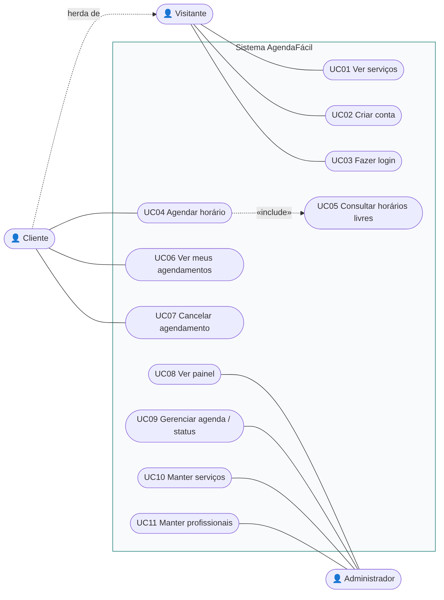
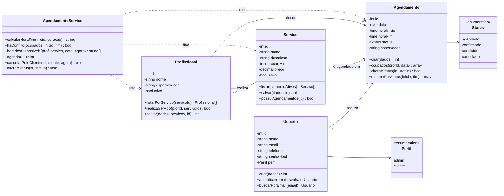
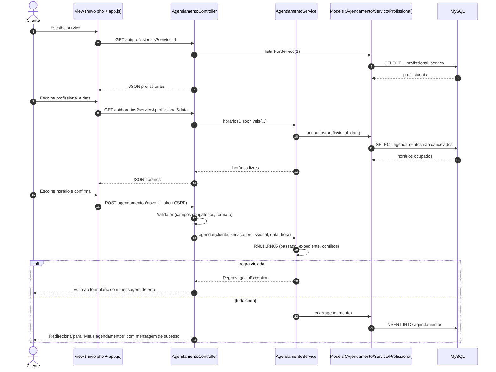
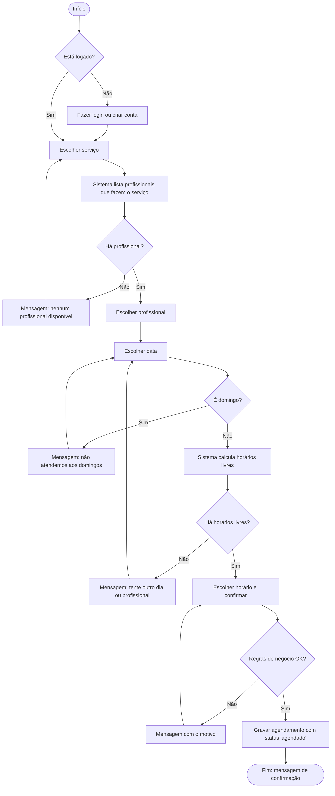
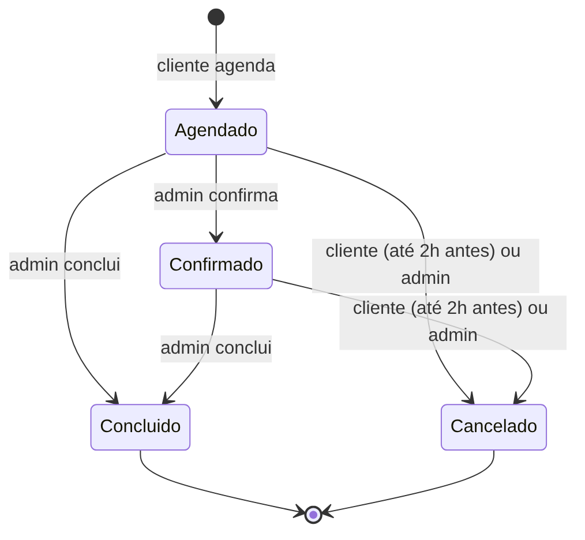

# Situação 1 — Modelagem UML (revisada)

Os diagramas abaixo foram escritos em **Mermaid** (o GitHub desenha automaticamente) e também exportados em PNG na pasta [`diagramas/`](diagramas/).

## 1. Diagrama de casos de uso



### Descrição do caso de uso principal — UC04 Agendar horário

| Item | Descrição |
|---|---|
| Ator principal | Cliente |
| Pré-condição | Cliente autenticado |
| Pós-condição | Agendamento gravado com status **Agendado** |
| Fluxo principal | 1. Cliente escolhe o serviço. 2. Sistema lista os profissionais que realizam o serviço (RN04). 3. Cliente escolhe profissional e data. 4. Sistema mostra apenas horários livres (UC05). 5. Cliente escolhe o horário e confirma. 6. Sistema valida as regras RN01–RN05, grava e mostra a confirmação. |
| Fluxo alternativo A1 | Domingo escolhido → sistema avisa "Não atendemos aos domingos". |
| Fluxo alternativo A2 | Sem horários livres → sistema sugere outro dia ou outro profissional. |
| Exceção E1 | Outro cliente ocupou o horário no mesmo instante → mensagem "Este horário acabou de ser ocupado" e o formulário volta preenchido. |
| Exceção E2 | Sessão expirada → usuário volta ao login e, depois de entrar, retorna para a tela de agendamento. |

## 2. Diagrama de classes



Mudança em relação à PIT I: as regras de negócio saíram do controller e foram para a classe **AgendamentoService**. Isso deixa o controller simples e permite testar as regras com PHPUnit sem abrir o navegador.

## 3. Diagrama de sequência — agendar horário



## 4. Diagrama de atividades — agendar horário



## 5. Diagrama de estados — agendamento



## Fontes Mermaid

Os arquivos `.mmd` em `diagramas/` podem ser editados e regerados com:

```bash
npx @mermaid-js/mermaid-cli -i diagramas/classes.mmd -o diagramas/classes.png
```
