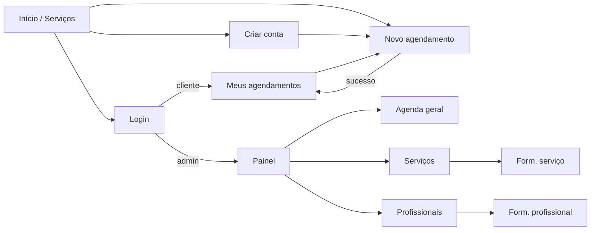

# Situação 1 — IHC (Interface Humano-Computador) e protótipo revisado

## 1. Mapa de navegação

## 2. Telas (protótipo funcional)

O protótipo da PIT I foi transformado em telas reais. Os prints estão em [`../situacao-2/telas/`](../situacao-2/telas/).

| Tela | Arquivo | Objetivo |
|---|---|---|
| Início | `01-home.png` | Apresentar os serviços e o botão "Agendar agora" |
| Criar conta | `02-cadastro-validacao.png` | Cadastro com validação em tempo real |
| Novo agendamento | `03-novo-agendamento.png` | Agendamento em 4 passos com horários em botões |
| Meus agendamentos | `04-meus-agendamentos.png` | Lista e cancelamento |
| Login com erro | `06-login-erro.png` | Mensagem clara de credenciais inválidas |
| Painel do admin | `07-painel-admin.png` | Indicadores do mês e atendimentos do dia |
| Agenda geral | `08-agenda-geral.png` | Filtros e mudança de status |
| Cadastro de serviço | `09-servico-validacao.png` | Validação no servidor |
| Celular | `12-mobile-home.png`, `13-mobile-menu.png` | Layout responsivo com menu recolhível |

## 3. Decisões de interface (heurísticas de Nielsen)

| Heurística | Como foi aplicada |
|---|---|
| 1. Visibilidade do estado do sistema | Mensagens "Buscando horários...", botão muda para "Enviando..." e alerta verde de confirmação |
| 2. Correspondência com o mundo real | Linguagem do salão: "serviço", "profissional", "horário"; datas no formato dd/mm/aaaa e valores em R$ |
| 3. Controle e liberdade do usuário | Cliente pode cancelar; botões "Voltar" nos formulários; alertas podem ser fechados |
| 4. Consistência e padrões | Mesmo estilo de botões e tabelas em todas as telas; vermelho só para ações destrutivas |
| 5. Prevenção de erros | Só aparecem horários livres; data mínima = hoje; confirmação antes de cancelar/excluir; botão desativado após o clique (evita duplicidade) |
| 6. Reconhecer em vez de lembrar | Duração e preço aparecem junto do nome do serviço; menu destaca a página atual |
| 7. Flexibilidade e eficiência | Botão "Agendar" em cada serviço já abre o formulário com o serviço selecionado |
| 8. Design minimalista | Formulário em uma coluna, apenas campos necessários |
| 9. Ajudar a reconhecer e corrigir erros | Mensagem embaixo do campo com borda vermelha, dizendo o que fazer |
| 10. Ajuda e documentação | Textos de apoio ("Atendemos de segunda a sábado") e manual de uso |

## 4. Mensagens do sistema

| Situação | Mensagem exibida | Tipo |
|---|---|---|
| Campo obrigatório vazio | "O campo Nome é obrigatório." | Erro no campo |
| E-mail em formato inválido | "Informe um e-mail válido." | Erro no campo |
| E-mail já cadastrado | "Este e-mail já está cadastrado." | Erro no campo |
| Senhas diferentes | "As senhas não conferem." | Erro no campo |
| Login inválido | "E-mail ou senha incorretos." | Alerta vermelho |
| Acesso sem login | "Faça login para continuar." | Alerta vermelho |
| Domingo | "Não atendemos aos domingos. Escolha outra data." | Aviso |
| Sem horários | "Não há horários livres nesta data. Tente outro dia ou outro profissional." | Aviso |
| Sem horário marcado | "Escolha um horário." | Erro no campo |
| Horário ocupado no envio | "Este horário acabou de ser ocupado. Escolha outro horário." | Alerta vermelho |
| Cliente com outro horário | "Você já possui outro agendamento neste horário." | Alerta vermelho |
| Cancelamento tardio | "O cancelamento só é permitido com 2 horas de antecedência. Entre em contato com o estabelecimento." | Alerta vermelho |
| Sucesso no agendamento | "Agendamento confirmado: Corte de cabelo com Ana Lima em 26/10/2026 às 10:00." | Alerta verde |
| Excluir serviço com histórico | "Este serviço possui agendamentos e não pode ser excluído. Desative-o em 'Editar'." | Alerta vermelho |
| Página inexistente | Página 404 "Página não encontrada" com botão "Voltar ao início" | Página |
| Erro inesperado | Página 500 "Erro inesperado" (sem detalhes técnicos em produção) | Página |

## 5. Acessibilidade

- Todos os campos têm `<label>` ligado ao campo.
- Link "Pular para o conteúdo" para quem navega com teclado.
- Foco visível em amarelo em todos os elementos interativos.
- Alertas de erro com `role="alert"`, lidos automaticamente pelos leitores de tela.
- Cores com contraste adequado (texto escuro em fundo claro, botão verde-petróleo com texto branco).
