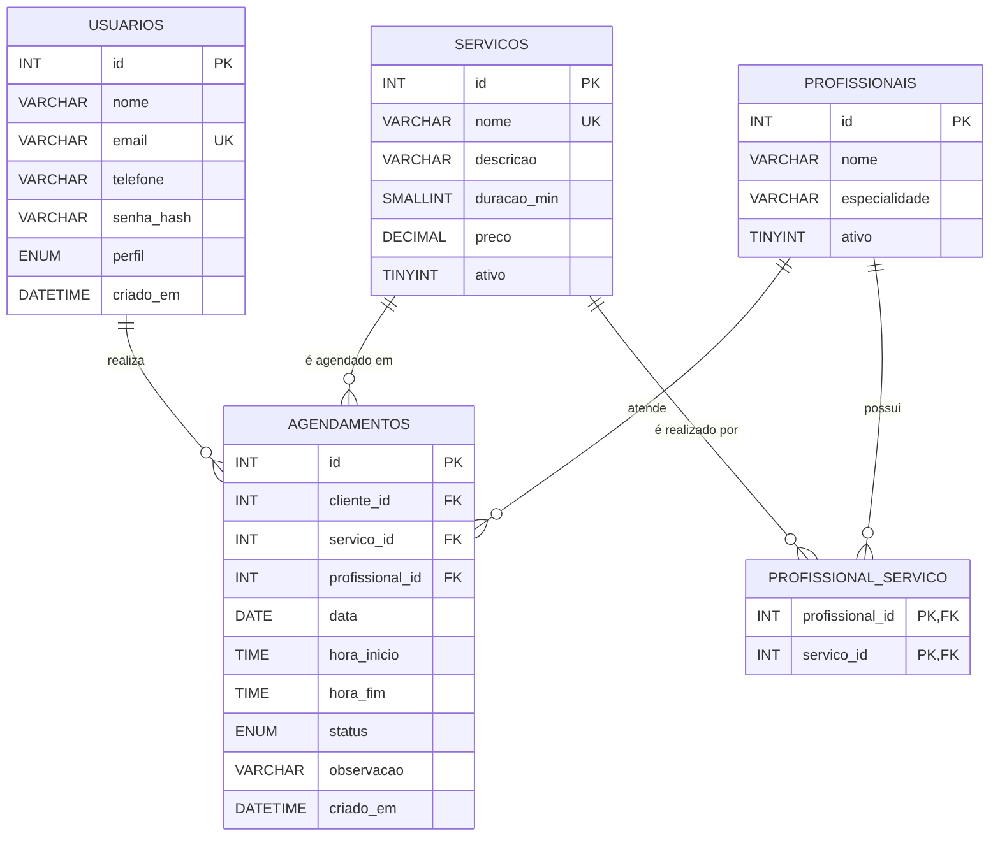

# Situação 1 — Projeto de banco de dados

SGBD escolhido: **MySQL 8.0**. É gratuito, muito usado no mercado, está disponível em praticamente toda hospedagem PHP e pode ser administrado pelo phpMyAdmin. Também funciona com MariaDB 10.4 ou superior.

## 1. Modelo conceitual

Entidades e relacionamentos:

- **Usuário** (cliente ou administrador) **realiza** 0..N **Agendamentos**.
- **Serviço** **é agendado em** 0..N **Agendamentos**.
- **Profissional** **atende** 0..N **Agendamentos**.
- **Profissional** **realiza** N **Serviços** e um **Serviço** é realizado por N **Profissionais** (relacionamento N:N).

## 2. Modelo lógico (normalizado)



```
USUARIOS (id PK, nome, email UK, telefone, senha_hash, perfil, criado_em)
SERVICOS (id PK, nome UK, descricao, duracao_min, preco, ativo)
PROFISSIONAIS (id PK, nome, especialidade, ativo)
PROFISSIONAL_SERVICO (profissional_id PK/FK → PROFISSIONAIS, servico_id PK/FK → SERVICOS)
AGENDAMENTOS (id PK, cliente_id FK → USUARIOS, servico_id FK → SERVICOS,
              profissional_id FK → PROFISSIONAIS, data, hora_inicio, hora_fim,
              status, observacao, criado_em)
```

### Verificação das formas normais

| Forma normal | Verificação |
|---|---|
| **1FN** | Todos os atributos são atômicos. Os serviços de um profissional, que no planejamento eram uma lista separada por vírgula, foram para a tabela associativa `profissional_servico`. |
| **2FN** | As tabelas com chave simples já estão em 2FN. Em `profissional_servico` não existe atributo que dependa só de parte da chave composta. |
| **3FN** | Não há dependência transitiva: o nome e o preço do serviço ficam só em `servicos` e são obtidos por JOIN. `hora_fim` é guardada de propósito (desnormalização controlada) porque o preço/duração do serviço podem mudar depois e o horário reservado não pode mudar junto, além de acelerar a verificação de conflitos. |

## 3. Projeto físico

O script completo está em [`database/schema.sql`](../../database/schema.sql) e os dados iniciais em [`database/seed.sql`](../../database/seed.sql).

Recursos usados para garantir integridade:

- `PRIMARY KEY` e `AUTO_INCREMENT` em todas as tabelas;
- `UNIQUE` em `usuarios.email` e `servicos.nome`;
- `FOREIGN KEY ... ON DELETE RESTRICT` em agendamentos (não deixa apagar serviço/profissional/cliente com histórico);
- `FOREIGN KEY ... ON DELETE CASCADE` em `profissional_servico`;
- `CHECK` na duração (10 a 480 min), no preço (≥ 0) e em `hora_fim > hora_inicio`;
- `ENUM` para `perfil` e `status`;
- índices `idx_ag_prof_data` (verificação de conflito) e `idx_ag_cliente` (lista do cliente);
- `utf8mb4` para aceitar acentos e emojis.

## 4. Dicionário de dados

### Tabela `usuarios`: clientes e administradores

| Coluna | Tipo | Nulo | Chave | Padrão | Descrição |
|---|---|---|---|---|---|
| id | INT UNSIGNED | Não | PK | AUTO_INCREMENT | Identificador do usuário |
| nome | VARCHAR(100) | Não | | | Nome completo |
| email | VARCHAR(150) | Não | UK | | E-mail de login (guardado em minúsculas) |
| telefone | VARCHAR(20) | Sim | | NULL | Telefone/WhatsApp no formato (99) 99999-9999 |
| senha_hash | VARCHAR(255) | Não | | | Hash bcrypt da senha (nunca a senha em texto) |
| perfil | ENUM('admin','cliente') | Não | | 'cliente' | Tipo de acesso |
| criado_em | DATETIME | Não | | CURRENT_TIMESTAMP | Data/hora do cadastro |

### Tabela `servicos`: catálogo de serviços

| Coluna | Tipo | Nulo | Chave | Padrão | Descrição |
|---|---|---|---|---|---|
| id | INT UNSIGNED | Não | PK | AUTO_INCREMENT | Identificador do serviço |
| nome | VARCHAR(100) | Não | UK | | Nome do serviço |
| descricao | VARCHAR(255) | Sim | | NULL | Descrição curta |
| duracao_min | SMALLINT UNSIGNED | Não | | | Duração em minutos (CHECK 10 a 480) |
| preco | DECIMAL(10,2) | Não | | | Preço em reais (CHECK ≥ 0) |
| ativo | TINYINT(1) | Não | | 1 | 1 = aparece para clientes; 0 = desativado |

### Tabela `profissionais`: quem executa os serviços

| Coluna | Tipo | Nulo | Chave | Padrão | Descrição |
|---|---|---|---|---|---|
| id | INT UNSIGNED | Não | PK | AUTO_INCREMENT | Identificador do profissional |
| nome | VARCHAR(100) | Não | | | Nome do profissional |
| especialidade | VARCHAR(100) | Sim | | NULL | Ex.: Barbeiro, Cabeleireira |
| ativo | TINYINT(1) | Não | | 1 | 1 = recebe agendamentos |

### Tabela `profissional_servico`: serviços que cada profissional realiza (N:N)

| Coluna | Tipo | Nulo | Chave | Descrição |
|---|---|---|---|---|
| profissional_id | INT UNSIGNED | Não | PK, FK → profissionais.id | Profissional |
| servico_id | INT UNSIGNED | Não | PK, FK → servicos.id | Serviço realizado |

### Tabela `agendamentos`: reservas de horário

| Coluna | Tipo | Nulo | Chave | Padrão | Descrição |
|---|---|---|---|---|---|
| id | INT UNSIGNED | Não | PK | AUTO_INCREMENT | Identificador do agendamento |
| cliente_id | INT UNSIGNED | Não | FK → usuarios.id | | Cliente que agendou |
| servico_id | INT UNSIGNED | Não | FK → servicos.id | | Serviço agendado |
| profissional_id | INT UNSIGNED | Não | FK → profissionais.id | | Profissional que vai atender |
| data | DATE | Não | | | Data do atendimento |
| hora_inicio | TIME | Não | | | Início do atendimento |
| hora_fim | TIME | Não | | | Fim, calculado pela duração (CHECK > hora_inicio) |
| status | ENUM('agendado','confirmado','concluido','cancelado') | Não | | 'agendado' | Situação atual |
| observacao | VARCHAR(255) | Sim | | NULL | Observação do cliente |
| criado_em | DATETIME | Não | | CURRENT_TIMESTAMP | Quando foi feito o agendamento |

### Índices

| Nome | Tabela | Colunas | Finalidade |
|---|---|---|---|
| idx_ag_prof_data | agendamentos | profissional_id, data, status | Consultar horários ocupados rapidamente |
| idx_ag_cliente | agendamentos | cliente_id, data | Listar "Meus agendamentos" |
